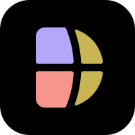
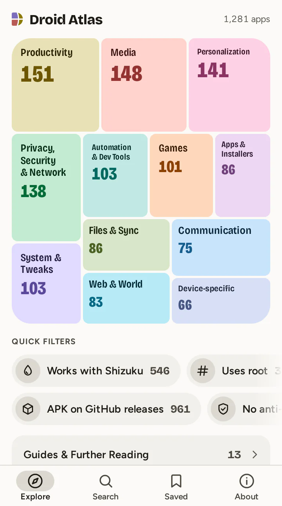
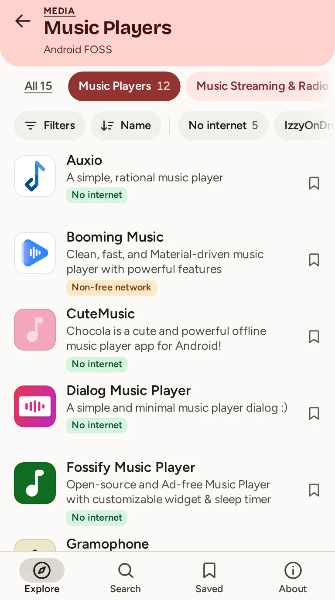
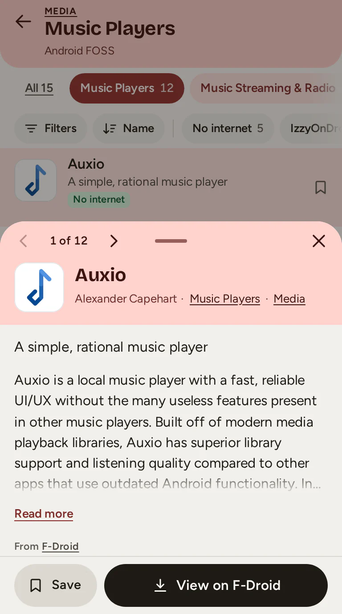

  

<h1 align="center">Droid Atlas</h1>

  A map of apps for Android™, mostly open source, drawn from two community lists.

  <a href="https://droidatlas.app/"><strong>Open Droid Atlas at droidatlas.app</strong></a>

  
  

  <a href="https://droidatlas.app/"><picture>
    <source media="(prefers-color-scheme: dark)" srcset="docs/images/explore-dark.webp">
    
  </picture></a>
  <a href="https://droidatlas.app/"><picture>
    <source media="(prefers-color-scheme: dark)" srcset="docs/images/category-dark.webp">
    
  </picture></a>
  <a href="https://droidatlas.app/"><picture>
    <source media="(prefers-color-scheme: dark)" srcset="docs/images/app-dark.webp">
    
  </picture></a>

Droid Atlas is a free website that you can also install as an app. It brings
together more than 1,200 apps from
[Android FOSS](https://github.com/offa/android-foss) and
[awesome-shizuku](https://github.com/timschneeb/awesome-shizuku). It adds
facts from F-Droid, IzzyOnDroid and GitHub, and names the source of each one.
There is nothing to sign up for.

## Why use it

Android FOSS and awesome-shizuku are community lists, and each is one long
page of names and links. To learn whether an app is still maintained, what its
license is or where to get it, you open its link. Then you open the next one.

Droid Atlas does that reading for every app, every day, and puts the answers
next to each name:

- **Search both lists at once.** Search finds an app by what it does, not only
  by its name. An app that both lists name appears once.
- **Ask what a list can't answer.** For example: which music players are on
  F-Droid, have no anti-features and had a release in the last 90 days.
- **Compare before you open anything.** Sort a category by GitHub stars or by
  latest release, and read each app's summary in the list.
- **See which projects have gone quiet.** Archived repositories, dead links
  and repositories that no longer exist are marked.
- **Read it on a phone.** A long page on GitHub is hard to use on a small
  screen. Droid Atlas is built for one.

Droid Atlas doesn't replace the lists, F-Droid or IzzyOnDroid. Every fact
names its source, and every app links to its own pages there.

## What you can do

- **Browse the map.** Regions such as Privacy, Media and Games open into more
  than 100 categories.
- **Search and filter.** Search by name, package or what an app does. Narrow
  the results by facts such as open source, no internet permission, on F-Droid
  or works with Shizuku, and pin a search to keep it.
- **Check an app before you get it.** An app's details show its description,
  statistics and who lists it, each with its source.
- **Get the app.** Buttons open the app's page on F-Droid or IzzyOnDroid, add
  it to Obtainium, or open its source code. Droid Atlas links to apps. It
  doesn't host, download or install them.
- **Save apps for later.** Add notes, and export your list to a file. Saved
  shows which apps had a release since you last opened it, and which are
  archived.
- **Use it offline.** After your first visit, the catalog opens without a
  connection.

## Install the app

To keep Droid Atlas on your phone's home screen:

1. Open [droidatlas.app](https://droidatlas.app/) in Chrome on your Android
   phone.
2. Select **About**, then **Settings**.
3. Select **Install Droid Atlas**.

If Settings shows no install button, open the browser's menu and select
**Add to Home screen**.

## Where the data comes from

| Source | What Droid Atlas takes from it |
|---|---|
| [Android FOSS](https://github.com/offa/android-foss) | Names, links and the list's categories |
| [awesome-shizuku](https://github.com/timschneeb/awesome-shizuku) | Names, links, descriptions and tags |
| [F-Droid](https://f-droid.org) and [IzzyOnDroid](https://apt.izzysoft.de/fdroid/) | Summaries, descriptions, licenses, versions, icons and download figures. Anti-features: their flags for things you may not want, such as ads or tracking |
| GitHub | Stars, activity, archived and moved repositories, latest releases |

The catalog is rebuilt every day from these sources. A build is published only
when every source was read and every check passed. Otherwise the previous
day's catalog stays in place.

The app shows the date its catalog was built. Its **Data health** page shows
what the build couldn't read, which links have gone stale and which projects
are archived.

### What Droid Atlas doesn't claim

- **It doesn't recommend or review apps.** The catalog lists what the two
  lists list. No app here has been checked for security.
- **Its labels aren't its own judgments.** Closed source, paid, uses root and
  works with Shizuku are what the lists and the indexes state.
- **It doesn't merge apps by name.** Two entries count as the same app only
  when a verified identifier matches, such as the app's Android package name.
  An app made from another app's code, a fork, stays a separate app.

## Privacy

- Droid Atlas has no accounts, no analytics and no cookies.
- The site makes no request to any other site until you select a link. Icons
  and fonts are served by the site itself.
- Saved apps, notes, settings and the date you last opened Saved are stored
  in your browser, on your device. They aren't sent anywhere. To move your
  saved apps, notes and settings to another device, export a file in
  **Settings** and import it there.
- Droid Atlas runs no server of its own. As with any website, the company
  that hosts its files can see ordinary request data, such as your IP address.

## Report a problem

- **An entry is wrong or missing.**
  [Open an issue](https://github.com/yyyyyyyan/droid-atlas/issues/new/choose),
  or write to hello@droidatlas.app. If the mistake is in one of the two lists,
  report it there too: the next build reads the list again.
- **You want an app's icon removed, or you have a licensing question.** Write
  to hello@droidatlas.app. A removed icon leaves the site with the next daily
  build.
- **Something in the app doesn't work.**
  [Open an issue](https://github.com/yyyyyyyan/droid-atlas/issues/new/choose).
- **You found a security problem.** Follow [SECURITY.md](SECURITY.md).

## Work on the code

A build step turns the lists into data files, and a web app reads them. There
is no server-side code. To run Droid Atlas yourself or change it, read
[CONTRIBUTING.md](CONTRIBUTING.md).
[docs/ARCHITECTURE.md](docs/ARCHITECTURE.md) explains how the parts fit
together.

## License and credits

The code is free software under the
[GNU General Public License, version 3 or later](COPYING).
Droid Atlas's own data (regions, identity decisions, computed facets) and its
configuration files are dedicated to the public domain under
[CC0-1.0](LICENSES/CC0-1.0.txt).

The catalog data on the site stays under its sources' licenses: Android FOSS
under GPL-3.0-only, awesome-shizuku under CC-BY-SA-3.0, the F-Droid and
IzzyOnDroid text under each app's license. Each data file says which.
[NOTICE.md](NOTICE.md) has the sources, credits, icon policy and trademark
notices. [REUSE.toml](REUSE.toml) gives the license of every file in the
repository.

Android is a trademark of Google LLC. Droid Atlas is not affiliated with or
endorsed by Google, GitHub, F-Droid, IzzyOnDroid or the developers of the apps
it lists.
